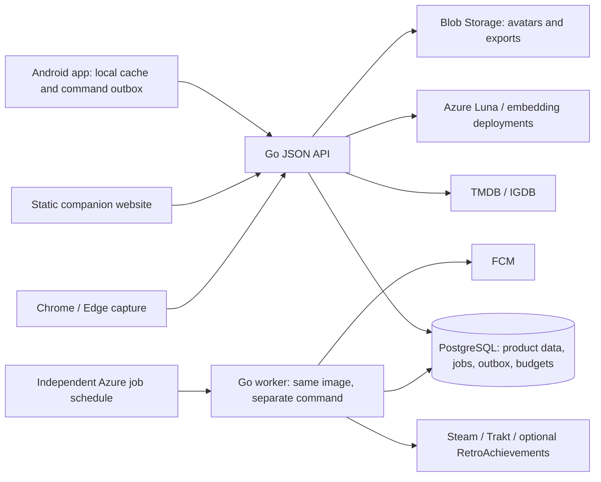

# Ludex Go backend and API proposal

**Status:** Approved architecture, implemented locally on 7 October 2026. The current Go API uses pgx typed SQL, app-owned Google sessions, a durable import worker and Azure adapters. This document retains the larger product target; [operations](../operations/go-beta.md) records actual implemented and unverified boundaries. Hosting and additional continuous provider sync remain release work.

## Recommendation and alternatives

Use one Go application, PostgreSQL in the existing Supabase project, JSON HTTP endpoints, database-backed background jobs, and the selected Azure model deployments. Split the Go application internally by product responsibility. Deploy the API as an Azure Container Apps Consumption candidate with minimum replicas zero, and run a scheduled job from the same image for connector polling/outbox work. Region, grants, scheduling interval, resource sizing and total cost need an actual subscription-specific quote.

Continuing TypeScript would preserve direct sharing of existing domain code, Zod schemas and Prisma tooling and offers the shortest migration. Go makes sense if compact deployments, explicit concurrency and a backend maintained in Go are the long-term preference; it requires porting the existing business rules and validating them against fixtures. A large framework/microservice system would add operational work before the 100-account beta needs it. The Go monolith is the recommended tradeoff, not a claim that language choice guarantees lower latency or a US$10 bill.

Prisma is a TypeScript/JavaScript data-access choice. With Go, replace its planned role with `pgx` typed SQL; keep PostgreSQL and the existing connection strings. Do not wrap a Go API around a separate Node/Prisma backend just for database queries. Existing schema/migration safety requirements still apply.

## Runtime shape



The API may sleep; due jobs remain durable in PostgreSQL. A scheduler independent of HTTP traffic wakes the worker. Goroutines or an in-process ticker do not replace that scheduler. On user return, bounded refresh requests may enqueue jobs; the product shows last successful sync and expected freshness. Catalog/provider outages must not block reading a saved feed or recording manual progress.

At beta scale, start with one small API replica when active and one worker execution at a time; tune memory/concurrency from measured load. Multiple processes still coordinate through database leases and idempotency constraints. A scheduled container launch can cost more than expected at high frequency: measure an adaptive schedule before promising near-real-time polling. Continuous presence requires observations while a client/source is active; sleeping API hosting cannot manufacture live activity from unsupported providers.

## Stack and layout

- Go stable version selected and pinned at implementation time; `net/http`, `chi` for route groups/middleware, `slog` for structured logs.
- `pgx` / `pgxpool` for PostgreSQL and explicit transactions; explicit typed SQL. Embedded versioned migrations run through the reviewed `ludex migrate` command.
- Handwritten shared TypeScript client contracts with integration tests against the Go API. The current OpenAPI file is a partial worksheet; full generated coverage remains a release improvement. Keep UI-only helpers in TypeScript.
- Small provider adapters using bounded HTTP clients; no provider call while holding a product write transaction. Azure OpenAI v1 integration can use a maintained Go SDK or a small typed HTTP adapter after current API verification.
- Azure Blob Storage for avatars/exports; direct FCM delivery for Android when configured. No Redis, Kafka, Kubernetes, API Management or paid standalone search requirement in this beta.

Target module vocabulary (the current implementation groups identity/library/social/curation in `internal/core`):

```text
apps/backend/
  cmd/ludex/              # serve, work commands
  internal/
    identity/            # Google, sessions, invites, device pairing
    catalog/             # title identity, metadata, availability provenance
    library/             # progress commands, runs, corrections
    social/              # follows, friends, blocks, feed, discussions
    showcase/            # profile shelves, collections
    connections/         # provider accounts, observations, imports
    assistant/           # retrieval, proposals, memory, budget ledger
    plans/               # shared shortlist, RSVP, scoped conversation
    notifications/       # inbox, FCM, digest preferences
    platform/            # config, database, HTTP, jobs, telemetry
  db/migrations/
  db/queries/
api/openapi.yaml
```

Handlers decode and validate input, establish identity, call the owning module and serialize results. Progress, permissions and normalization live in modules, not repeated per route. Avoid a generic document repository mirroring Cosmos in SQL: concrete relational queries should perform filtered joins and pagination. Introduce an interface for an actual replaceable dependency such as a provider client or clock, not one interface per file.

## Core domain and data

A **title** is a canonical movie, show or game identity. An **episode** is a show unit. A **run** is a user's distinct viewing/playthrough so rewatches/replays are not duplicates. A **session** is a bounded period of watching/playing, independent of completion. A **provider observation** is external evidence. A **progress event** is an accepted fact used to update the library. An **activity** is an explicitly shareable projection for the feed, not every piece of evidence. **Presence** is a separate expiring signal. A **milestone** describes game progress; a provider achievement does not necessarily prove story completion.

Suggested table groups:

| Module | Main records |
| --- | --- |
| Identity | users, provider identities keyed by issuer/subject, sessions, invites, devices |
| Catalog | titles, provider IDs, releases/platforms, episodes, achievement definitions, metadata cache |
| Library | library entries, runs, sessions, episode progress, achievements, milestones, progress events, command receipts |
| Social | follows, friendships, circles/members, blocks/mutes, activities, reviews, reactions, discussions/replies, reports |
| Showcase | profiles/themes, shelves/shelf entries, collections/entries |
| Connections | connections, encrypted token versions, sharing policies, observations, import batches/matches, sync cursors |
| Assistant | conversations, approved memories, action proposals, permitted retrieval documents/embeddings, budget reservations/usage |
| Plans and delivery | plans/participants/shortlists, notifications/preferences, jobs, transactional outbox |

Enforce uniqueness in the database for command receipts, provider identities, follow edges, episode completion within a run, and source-specific observation identities. Keep ambiguous provider/title mappings in review. Use typed columns for product relationships; JSONB may hold validated provider payload fragments and action-specific event data. Record source, occurred time with precision, observed time and import batch. Unknown historical dates remain unknown rather than manufactured exact timestamps.

Ownership/edition/emulator/device fields remain distinct from play progress. Achievement identity includes provider/game/achievement/mode as needed. Never infer game completion from playtime, a running process or an arbitrary achievement. TV completion needs a policy for aired episodes versus ended series, so newly released episodes do not silently rewrite an old run's history.

## Progress, retries and public sharing

All writes enter the same command module whether initiated manually, by an import, by a connector or by a confirmed assistant proposal.

1. Authenticate actor, validate title/unit/run identity and permissions.
2. Check unique actor + command ID and its normalized request hash. The same ID/body returns the saved result; the same ID with different content is rejected.
3. Check expected library version and applicable correction/connection policy. Conflicting manual edits return a stable `409` response; the app refetches and offers a reapply choice.
4. In one database transaction, append the progress fact, update affected current rows, store the command receipt, and record eligible activity plus outbox delivery work. Core saved progress and shareable activity need no asynchronous gap.
5. Commit before acknowledging. Deliver external notifications and slower derived work asynchronously, with retries.

This is current state plus an audit/event log for progress, not a proposal to event-source every part of the application. External delivery is at-least-once with idempotent effects, not a promise of exactly-once HTTP or push.

Feed cards may group episodes/achievements from the same session, preserving every underlying fact; grouping updates an existing card rather than flooding followers. Saving from a post retains a recommendation pointer that is resolved only while the source remains visible. Regional availability and episode release dates carry provider/time/region provenance; absent coverage is shown as unknown.

Connector ingestion first stores an observation, normalizes identity and checks confidence. Exact permitted observations may become commands. Ambiguous Netflix identification, seek jumps, unsupported account privacy or missing completion evidence produce a review item or confirmed capture, not automatic completion. Historical imports do not flood followers with old posts. Source/event-specific sharing is checked before activity creation and again before delivery. Live presence has its own audience, opt-in policy and expiry.

Corrections append a correction/retraction and rebuild the affected run/entry as necessary, updating or retracting linked activities. Preserve manual edits when a source reappears. Import previews expose unmatched titles, ratings mappings, duplicates, date precision and chosen audience before committing a batch. Undo uses source provenance, not deletion of every matching title.

## API contract

Use `/api/v1` for the new API with opaque IDs, UTC timestamps plus explicit partial-date types where needed, bounded sizes, request IDs, consistent problem responses and cursor pages. Command bodies preserve current `commandId`, `baseVersion`, audience and spoiler concepts. Collection/showcase edits also use versions. Responses report persisted state/version rather than optimistic success.

| Capability | Representative endpoints |
| --- | --- |
| Identity | Google start/callback, native sign-in exchange/challenge as selected, session refresh/logout, `GET /me` |
| Catalog | `GET /catalog/search`, `GET /titles/{id}`, episodes/achievements; cached data and provider status |
| Library | `GET /me/library`, `GET /me/library/{titleId}`, `POST /progress/commands`, `POST /progress/{eventId}/corrections` |
| Social | `GET /feed`, `GET /activities/{id}`, idempotent follow/block changes, review draft/publish, reactions/replies |
| Showcase | `GET /users/{id}/showcase`, versioned showcase/shelf editing, collections |
| Connections | list capabilities/status, connect/disconnect, sharing policy, refresh enqueue, observation upload/review |
| Imports | upload/preview, paginated matching review, commit, job status, batch undo |
| Assistant | create message/stream answer, inspect memory, action proposal list/confirm/reject, allowance status |
| Plans | create plan, shortlist/RSVP/time updates, scope-specific discussions |
| Notifications | inbox/read state, preferences, device push registration |
| Account/operations | export request/status, deletion, moderation/report handling; private operational diagnostics |

Uploads use capped, authenticated upload sessions and validate size/type before processing. Import ZIP parsing rejects path traversal, oversized expansion and excessive entries; preview and matching jobs retain the source file only under a documented retention window. Preserve existing beta limits from the product spec unless a new explicit decision changes them. Avatar processing strips metadata and caps dimensions, and signed Blob URLs never grant access to another user's private import/export.

Long tasks return `202` plus a job ID/status URL. Feed/library reads use keyset pagination; private ETags include viewer and policy/progress revisions. Use private caching and never a shared CDN cache for personalized responses. Errors distinguish unauthorized, unavailable/not-visible, stale version, rate limited, source unavailable and budget exhausted without revealing hidden resources.

The user selected a fresh PostgreSQL beta with Google accounts, retaining a local export of Stage A test data. Before cutover, create and verify that export/SQLite snapshot; do not delete the local data during this design task. No automatic mapping of local password accounts to Google users is needed. Future user-triggered import still previews records and checks duplicates; never attach local data to a Google identity by email match alone.

During porting, temporary compatibility routes may retain current `/api/...` contracts so screens still work. Freeze external contract fixtures, run the same progress/spoiler/visibility scenarios against both backends, then update the generated client and retire compatibility routes after client migration. Existing password-login UI is replaced by Google, not quietly carried into production. Do not keep TypeScript and Go as permanent duplicate business-rule authorities.

## Identity, privacy and AI

Use direct Google identity, followed by Ludex-owned sessions. Native and confidential Web OAuth flows must be finalized separately, with audience/issuer/expiry and nonce/state/PKCE validation as applicable. Key identity by Google's subject plus issuer rather than display name/email. Invitations and moderator bootstrap are checked server-side. Browser sessions use secure HttpOnly cookies with appropriate CSRF protection; Android uses securely stored, scoped short-lived access/session credentials and revocable rotating refresh credentials. Extension pairing uses short-lived one-time codes and scoped sessions; provider secrets never reach clients.

Authorization applies on every read/write and every derived channel: feed, showcase, notifications, exports, search and assistant context. Spoiler scopes are checked from permitted actual progress, and blocks override follow/friend visibility. A hidden item must not leak through counters, search snippets or model citations. Background work rechecks permissions after policy changes. Cache invalidation includes a policy revision. Use a dedicated restricted database role rather than the supplied privileged owner login in deployed runtime; migration role stays separate. No public Supabase data API is exposed just because the database is hosted there.

The assistant runs fast structured search first and uses embeddings for permitted fuzzy matches. Retrieve only approved records the actor can view, with spoiler checks before any text reaches the model; the final response is also checked for unsafe citation scopes. Match embedding deployment/dimensions/version when indexing and querying. For a beta-sized corpus, exact cosine search can avoid premature approximate-index setup; verify pgvector availability and chosen dimension/index constraints.

`gpt-6-luna` explains results and proposes typed actions; it gets no arbitrary SQL or privileged provider credentials. Each write is a stored proposal with validated payload, actor, expiry, target version and visible preview. Confirmations are bound to the stored proposal ID, exact payload hash, actor and expiry. Consume them atomically with the command receipt; a repeated confirmation returns its saved result and cannot execute twice. Confirming rechecks permissions/version and executes through the normal command module; even memory changes/publication need confirmation in beta. Model text and imported content are untrusted data.

Reserve a bounded maximum billable call cost atomically in PostgreSQL before cloud calls, including chat reasoning/output tokens, embeddings and any follow-up calls. Finalize using returned usage; failed/time-out calls can still be billed, so do not immediately refund unknown outcomes. Per-user allowance plus a shared cap, output/context limits, concurrency control, request deduplication and a manual/text-search fallback come before cloud AI enablement. One displayed answer may contain several calls; every call is metered. Exact prices/usage reporting remain to be verified.

## Latency, hosting and recovery

The existing database connection geography should guide API placement; verify the actual Supabase project region rather than assuming a nearby Azure region. Set small aggregate database connection limits for API replicas and worker. Supabase documents that transaction pooling does not support prepared statements. For the supplied runtime transaction URL, configure pgx with `DefaultQueryExecMode=pgx.QueryExecModeExec` and verify integration tests; remove Prisma-specific URL parameters from the Go driver configuration rather than assuming they are PostgreSQL connection options. Keep the session connection for migrations/session-bound tasks, or deliberately choose a capped session pool for the backend after connection-budget review. Confirm TLS hostname/certificate verification for the deployed connection.

The phone renders cached feed/showcase immediately, stores offline commands durably and shows pending/failed/conflict state. Warm API latency targets are to be measured separately from cold-start and international round trips. Suggested beta measurements: p50/p95 API and DB time, first visible cached frame, successful command acknowledgement, connector lag and worker backlog. No global sub-second promise.

Jobs use lease owner/expiry, retry backoff with jitter, provider rate budgets, attempts and a terminal failed/review state. PostgreSQL row claiming such as `FOR UPDATE SKIP LOCKED` supports safe workers if selected and tested. Handle process death and duplicate source delivery in integration tests. Imports, exports and provider refresh never monopolize HTTP request time.

Log redacted structured errors and timings, not OAuth tokens, database URLs, RA query keys or private model context. Cap telemetry storage/ingestion. Separate liveness from database readiness, add bounded DB/provider timeouts, graceful shutdown and restore-tested backups. Verify Supabase backup availability on the actual plan; free-plan pause/backup limitations affect beta reliability. Deletion cancels queued work, revokes sessions/connections and applies a documented retention policy to private source data and derived retrieval records.

Direct replies, mentions and plan invitations appear in a durable in-app inbox immediately; FCM delivery is best-effort and may await the next worker execution when the API is asleep. Ordinary followed progress creates no default interrupt. Foreground feed refresh starts at the existing 30-second beta cadence with backoff/background suspension; presence uses the existing five-minute expiry. An SSE connection can optionally stream a user-requested AI answer without introducing permanent feed sockets.

Official documentation confirms that Container Apps can scale to zero, and that scheduled Consumption Jobs are charged for active CPU/memory use and share subscription-level grants with the API. The detailed primary-source note is [Go hosting and database research](../research/go-backend-hosting-2026-10-07.md).

The US$10 target is a quote-and-measure gate. Container Apps consumption, job startups, database plan, Blob/egress, logging, AI requests and external provider terms all contribute. Scale-to-zero lowers idle compute but adds cold starts, and a free grant does not establish eligibility or cover every line item. Credits reduce cash payment, not usage cost.

## Delivery order and approval boundary

1. Approve Go/PostgreSQL/API contract design; resolve native Google flow, database schema and quoted hosting region.
2. Add Go skeleton, migrations against a disposable database, OpenAPI/contract fixtures, real Google session flow.
3. Port core library/progress and cinematic feed/showcase endpoints; prove parity, privacy, correction/retry behavior and two-account persistence before switching clients.
4. Integrate TMDB/IGDB, importer previews, Steam, extension capture and optional RA through durable observations/jobs.
5. Add constrained AI retrieval/confirmations/budget enforcement, shared plans and FCM; validate real provider/device behavior.
6. Quote deployment, run concurrency/cold-start/job failure tests, restore/delete drills, then deploy the invited beta.

This proposal keeps the prior credential templates useful, but the `Prisma` description remains the previous TypeScript plan until the user approves the Go change. The populated server env file stays in its current ignored location. No backend code, dependency installation, production deployment or database migration is part of this design task.
