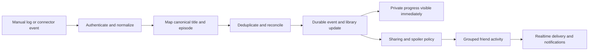

# Ludex product brief

Date: 2026-10-06

Status: product interview completed; implementation plan requested; no application features or integrations implemented

Platform decision: mobile app first, with a companion website, as selected by the user

Current beta constraints: Android only, global English-speaking free non-commercial beta, approximately 100 invited accounts with 10–20 simultaneous users, and a US$10/month target potentially subsidized by existing Azure credits/deployments. AI is a central conversational companion with capped short replies and structured fallback, minimal permitted personal context and confirmation before every write. Selected automatic sharing follows explicit source opt-in, including optionally public presence with a separate control. Shared plans/scoped discussions, optional ten-point ratings/likes/text, direct-interaction notifications and curated configurable showcases are selected. Steam plus desktop Chrome/Edge Netflix quick capture with optional detection is the initial integration route. Importing existing history/ratings/catalogs and emulated-game provisions are required. Exceptional cinematic showcase/feed is the first acceptance priority. [The deeper design](ludex-experience-depth.md) records the completed migration and delivery decisions.

Revision during product interview: first audience is TV/PC gaming friend groups; public followers, reviews and discovery are central; account connections may be supplemented by optional extension/desktop companion; visual direction is an atmospheric cinema lounge; target is a polished private beta. [The deeper experience design](ludex-experience-depth.md) records these decisions and supersedes preliminary recommendations where indicated.

## 1. Product promise

**Your movies, shows, and games, shared with your people.**

Ludex is a personal entertainment library and social journal. It helps people keep track of what they watch and play, express their taste, and share the moments that matter with friends. Progress supplies context for conversation and discovery. The interface should feel fast, personal, visually distinctive, and usable in a few seconds between episodes or game sessions.

The first audience is people whose entertainment spans film, television, and games and who already recommend titles in group chats. The product must remain useful before they have friends: a good library, an attractive profile, and useful discovery are the foundation. Friendship adds shared context and reasons to return.

Success means people record and discuss experiences with less effort. More hours spent watching or playing is not a success metric.

## 2. Three possible directions

| Direction | Strength | Tradeoff |
| --- | --- | --- |
| **Friend-centered entertainment journal — recommended** | Progress, collections, and discovery strengthen one social loop. Useful alone, richer with friends. | Requires thoughtful feed grouping, permissions, and spoiler handling. |
| Automatic tracking utility | Clear utility and easy demonstrations when a connector works. | The product depends heavily on inconsistent external APIs; collecting history does not itself create social value. |
| AI entertainment concierge | Strong discovery and cross-media recommendations. | It is harder to differentiate without meaningful personal history; generation adds cost and latency. |

Ludex should use the first direction, with tracking and AI integrated into its everyday actions.

## 3. Daily experience and navigation

Primary mobile navigation: **Feed, Library, Discover, Profile**. Feed contains Following and a friends/circle filter. A prominent Log action is available from any screen and title page. Notifications sit in the top bar. The companion website shares accounts and data and supports profiles, lists, discovery, and larger library edits; it need not reproduce every mobile interaction.

Example journey, using illustrative activity:

1. Open Feed and see that a friend finished an episode of a show you also watch.
2. React, enter a spoiler-safe discussion, or save the show if you have not started it.
3. Tap Log to mark your own next episode watched, or accept an imported playback update.
4. The library updates immediately; the social post follows the user's audience and sharing preferences.
5. Discover offers a short list for tonight based on available time, mood, subscriptions, and what selected friends have already seen.

Manual logging is a first-class route. Importing or syncing is an optional convenience, and connecting an account is not required to start using Ludex.

## 4. Friends and activity feed

### Relationships

The user selected a public-first social model. Use directed follows for public reviews, collections and permitted activity, plus mutual accepted friendships/circles for separately restricted progress. A follower does not automatically gain access to private notes or live presence. Public profiles and discovery are core features. Completion sharing follows explicit source/event-type opt-in; presence is a separate preference.

Features: invite links, username search, requests and acceptance, close-friend audiences, mute, block, reporting, and configurable notifications. Blocking revokes activity access and interactions in both directions. Private accounts expose only the chosen public profile surface.

### Feed events

Supported event concepts:

- Started or finished a movie; rewatched a movie.
- Started a show; watched an episode; finished a season; became caught up with released episodes.
- Started or resumed a game; finished a session; unlocked an achievement; recorded a milestone; completed a playthrough; reached a defined completionist goal.
- Posted a short review, built a collection, or recommended a title to a friend.

Events should have a compact default presentation: person, action, title, time, progress context, and optional reaction or note. Show covers and artwork where they improve recognition. Detailed events can expand into a richer card.

Group related imported activity. Three episodes watched in one sitting should form one expandable session. Multiple achievements from a gaming session should become one summary with significant achievements visible inside it. Historical imports populate the library without flooding the current feed or sending old notifications. Low-confidence observations can wait for user confirmation.

The proposed Following feed is chronological among visible followed accounts, with friends/circle and media filters. Broader recommendations live in Discover and should be explainable. Users can mute individual titles or authors. Following is chronological; recommended discovery is a separate surface under the technical plan.

The user selected explicit per-source sharing followed by selected automatic completion/achievement posts. Historical imports remain quiet. Live presence and starts have separate opt-in controls; presence may also be public. A private log updates the library without publishing an activity. Users can edit notes, retract activities, and change their sharing preferences.

### Social features that deserve priority

- Reactions and short comments, with controls for activity and notification spam.
- A **watch/play next queue** showing titles shared with friends and the next episode or unfinished game.
- **Buddy runs:** agree to watch a season or play a game in roughly the same period; compare progress without competitive streak pressure.
- **Shared shortlists:** friends nominate titles, optionally vote, and ask Ludex to find an option that fits everyone.
- **Progress-aware discussion:** episode-specific discussion and milestone-specific threads. Game milestone prerequisites form a graph; game progress is not a universal linear percentage.

A synchronized player, streaming distribution, full messaging system, and universal console telemetry are outside the first release. Shared planning and discussion work without those systems.

## 5. Library and profile

The library combines media under one identity while retaining meaningful progress rules for each type.

| Media | Useful states | Progress detail |
| --- | --- | --- |
| Movie | Want to watch, watching, watched, abandoned | Dated viewings and rewatches; optional resume position when a connector provides it. |
| Television | Plan to watch, watching, paused, caught up, finished, dropped | A set of watched episode IDs and separate viewing runs; next unwatched episode; specials handled explicitly. Caught up and finished are different. |
| Game | Backlog, playing, paused, completed, dropped | Platform, edition, playthrough, achievements, optional hours, and user-recorded milestones. Story completion and all-achievement completion are separate. |

Ownership and access are separate from progress: a purchased game can remain unplayed, and a watched movie need not be owned. Users can record physical/digital editions, platform, subscription access, and personal collections. Dynamic streaming availability is region-specific metadata with a freshness timestamp, not a permanent entitlement.

Support optional ten-point ratings, likes/favorites, notes, dates, custom shelves, sorting and filtering, source-specific plus mapped CSV import/export, and bulk editing on the website. Import existing library/history/ratings/list records where source exports support them; preserve original scales/date precision and keep historical imports quiet. Uncertain matches appear in a review queue. Explicit title/edition mapping preserves viewing/playthrough history. Emulated games retain original platform/edition separately from played-on device/emulator and achievement source.

Profiles are curated personal spaces with a constrained visual system: header artwork, avatar, short bio, favorite films/shows/games, a currently watching/playing shelf, pinned collections, selected achievements, and an optional activity calendar. A small set of themes and modular shelf layouts gives identity without arbitrary slow widgets.

Allow a user to showcase a self-reported milestone; show its source appropriately. An imported achievement should name the provider rather than implying Ludex verified gameplay itself.

Useful longer-term features include annual recaps, retrospective comparisons, collaborative collections, and cross-media collections such as a franchise spanning films and games.

### Integration across media

Every title screen connects the catalog to the user's actual social world: friends who watched or played it, permitted reviews, personal progress, relevant collections, and an action to recommend or plan it together. Discover can recommend a friend's collection; the feed can save a title directly to the library; a library item can start a shared shortlist. These routes use the same records and permissions.

Represent films, shows, episodes, games, and editions as distinct canonical entities with provider-ID mappings. Add typed relationships such as part of a franchise, adaptation of, and sequel to when supported by catalog data or deliberate curation. Keep metadata relationships separate from AI-generated thematic similarity.

A cross-media **Journey** is a curated collection, for example films and games in one fictional universe or works sharing a theme. Its order and completion requirements are explicit and editable. It does not pretend that one game's playtime and one show's episode count share a universal progress percentage.

## 6. Spoiler handling as a core mechanic

Spoilers include title text, achievement names, episode thumbnails, notes, comments, notifications, search suggestions, AI outputs, and generated summaries.

For a show, visibility can use explicit episode/season scope and the viewer's watched episode set. A viewer who skipped episode 4 is not automatically considered safe for all events through episode 7. Notifications use neutral copy when their detailed payload is gated. Rewatches preserve an optional previously-seen baseline separately.

For a game, prefer explicit milestone prerequisites, achievement-specific scopes, and user consent. Playtime or achievement percentage cannot establish that the user reached a story moment. Where the game has no reliable spoiler map, conceal names and descriptions by default until revealed. A friend can post “reached a milestone” without revealing its identity.

Unknown progress defaults to hidden spoilers. Permit explicit reveal for the current item and an optional per-title spoiler preference. Automatic classification can assist authors, but explicit scopes and conservative access rules provide the protection. AI requests receive only material that the user may access and that is safe for their selected progress boundary.

## 7. AI integrated into the product

The user selected a central conversational AI companion. Provide a persistent reachable conversation with contextual entry points beside search, shared choices, memory, collections and logging. Direct navigation/actions remain fast and usable independently. The user accepts capped short cloud replies with structured fallback to fit the subsidized US$10/month target. Use minimal relevant permitted personal context with explicit controls and confirm every assistant write in beta.

| Capability | Example | Inputs and boundary |
| --- | --- | --- |
| Natural-language search | “A tense science-fiction film under two hours that two friends liked.” | Parse runtime/media constraints; retrieve authorized catalog and friend data; explain why each result fits. |
| Group decision helper | “Something all three of us can watch tonight in India.” | Use explicit group consent, region, provider availability, runtime, and watched history; never promise playback access from stale catalog data. |
| Cross-media recommendations | “I liked this game’s exploration and loneliness; suggest a film or show.” | Ground the explanation in permitted metadata and personal choices, with an option to exclude already-consumed media. |
| Backlog assistant | “What fits a 45-minute break?” | Suggest an episode or plausible game session. Mark game-session length as an estimate, not a guarantee of completion. |
| Natural-language logging | “Finished season two yesterday; keep it private.” | Resolve titles and episodes, show the proposed change, and require confirmation for ambiguous or bulk changes. |
| Spoiler-safe recap | “Remind me what happened through episode three.” | Only retrieve appropriately scoped episode/chapter material. If safe source coverage is missing, decline to invent a recap. |
| Personal memory search | “What was the film a friend recommended last month?” | Retrieve only currently accessible notes, recommendations, and activity. |
| Optional recap and collection drafts | A session digest or thematic shelf | A derived, labeled draft that links back to the original records; user approves public creative text. |

### Search and RAG

RAG means retrieving relevant source material and giving it to the model so the answer can be grounded in records instead of relying on model memory.

Use a hybrid search pipeline:

1. Apply structured constraints such as media type, runtime, language, provider, region, ownership, and watched state.
2. Combine full-text search for exact names with embeddings for concepts, moods, and themes.
3. Enforce requester permissions and spoiler scope before retrieval. Search result snippets and embedding documents must respect the same rules.
4. Rank retrieved candidates using permitted personal and friend preferences.
5. Generate a short optional explanation with source links and stated uncertainty.

Show useful search results before optional AI explanation finishes. Cache public catalog work independently from user-specific results. Personalized cache keys include user, permissions, and relevant progress versions. A change in friendship or access revokes cached private results and derived answers. Do not let an LLM choose database access permissions.

AI cannot infer that someone watched, beat a boss, or finished a game and write that as fact. Write tools validate explicit intent, permissions, identifiers, and action scope. Provide undo for supported actions and previews for ambiguous or consequential bulk edits.

### What makes the AI useful

Start with hybrid discovery, group shortlisting, and natural-language logging. These have measurable outcomes. Recaps require a separate evaluation of source coverage and spoiler leakage before release. Compare AI recommendations with simple genre/runtime/friend filters; measure saves, starts, constraint satisfaction, response time, and per-action cost. Use a small repeatable evaluation set of permissions, false progress, wrong titles, and spoiler leakage.

For cold starts, ask for a few favorite titles and an optional mood or time budget instead of demanding a long preference questionnaire. Let users inspect and correct the factors driving recommendations. Group members opt in to contributing private preferences; generated explanations must not disclose another member's hidden history.

## 8. Progress synchronization

The integration report in [progress-sync-feasibility.md](../research/progress-sync-feasibility.md) records researched provider capabilities and prerequisites. Documentation establishes feasibility; no authenticated integrations have been tested.

| Source | Practical product use | Required boundary |
| --- | --- | --- |
| Steam | Poll allowed library and game-published achievement data. | Visibility-dependent; OpenID does not unlock private data; no generic boss events. [Official achievements API](https://partner.steamgames.com/doc/webapi/isteamuserstats) |
| Trakt | Import the connected user's movie/episode history; optionally write back explicitly authorized logs. | Confirm app access and policy fit. Scrobble endpoints accept client writes; they are not a push feed into Ludex. Share only user-chosen Ludex activity, not harvested Trakt community data. [API use policy](https://developer.trakt.tv/docs/api-use-policy) |
| Plex | Receive configured playback and watched events for eligible users. | Plex Pass prerequisite, reachable callback, user/account filtering, tested delivery and deduplication. [Webhook documentation](https://support.plex.tv/articles/115002267687-webhooks/) |
| Jellyfin | Read authenticated self-hosted server session/playback information. | Network reachability and least-privilege access; broader server visibility can require privileged credentials. [Session API](https://typescript-sdk.jellyfin.org/classes/generated-client.SessionApi.html) |
| Netflix and Letterboxd exports | User-initiated historical import with title-matching review. | Snapshot history, not live telemetry; export access does not establish unrestricted API access. [Netflix viewing activity](https://help.netflix.com/en/node/101917), [Letterboxd API access](https://letterboxd.com/api-beta/access/) |
| Direct consumer streaming and console services | Fast manual logging at launch. | Reviewed sources did not establish universal public progress access; revisit only with documented access or partnership. Details and sources are in the research report. |

Use TMDB for film/TV metadata and IGDB for game metadata only after confirming applicable access, attribution, artwork, and commercial terms. Catalogs identify titles; they do not establish what a user consumed. [TMDB FAQ](https://developer.themoviedb.org/docs/faq), [IGDB documentation](https://api-docs.igdb.com/)

### One shared progress pipeline

Keep a durable activity log plus derived library state. This gives an auditable source for correction and deduplication without requiring a full event-sourcing framework for every feature. Core database writes and an outbox entry happen in one transaction; workers publish only committed events and can safely retry.

Each incoming event includes source, provider account, external event ID when available, canonical entity, occurrence time, ingestion time, observation versus inferred status, and confidence. Use provider identities and replay-safe idempotency keys to avoid publishing duplicates. Where a provider offers only snapshots, compute a diff against the stored checkpoint; an initial snapshot is a historical import, not live activity.

Library progress and social publication are separate outputs. A verified webhook can update a private library without the user sharing it. An observation that a game launched may offer “playing now,” but cannot mean a session ended or a story completed.

### Corrections and conflicts

- Preserve watched episode sets, viewing runs, and playthroughs rather than overwriting them with one maximum number.
- A user correction takes precedence in Ludex. Store its scope and prevent a later replay of the same provider snapshot from undoing it. Offer explicit reconciliation if new source information conflicts.
- Out-of-order events use occurrence time and stable identities. They do not silently regress newer confirmed progress.
- Disconnection stops collection and hides live presence. Account deletion removes associated private records, derived search artifacts, and cached personal answers under the product's retention policy.
- Each connector exposes connected, syncing, stale, rate-limited, permission-limited, failed, and disconnected states. Show last successful sync and a manual retry option.
- Two-way synchronization is enabled separately per supported provider. Never write back by default or create loops by reimporting Ludex's own exports.

### Product promise

Promise **automatic updates where supported, a fast log action everywhere else**. Push sources can feel immediate; polling sources have a visible refresh window. The product must not advertise universal real-time streaming or console progress.

Steam achievements can supply milestones where the game publishes suitable achievements and account visibility permits access. Arbitrary boss defeats require achievement mapping, an explicit game integration, or manual logging. AI can help interpret a description, but cannot create missing telemetry.

Possible future extensions include a user-authorized browser extension for explicitly supported playback websites and a local desktop companion for supported game integrations. These need separate feasibility work, transparent permissions, and maintenance for changing sites. A mobile application alone cannot universally observe playback inside other apps or arbitrary events inside console games.

## 9. Visual direction

The user selected an atmospheric cinema lounge. Develop ink-plum/smoked-indigo surfaces, pearl text, restrained violet/copper accents, expressive display type and readable social text. A proposed signature session spread combines artwork, a personal note and a clear progress marker. Exact tokens, typography and screen compositions remain subject to visual review; the earlier lime-on-black proposal is superseded.

Feed should look like a readable social journal, with compact activity rows and occasional expressive cards for major moments. Library uses dense but legible cover shelves and clear progress indicators. Profiles feel like a curated collection wall. Discover gives search and brief explanations space to read.

Use subtle haptics and brief feedback for saving, logging, and reacting. Avoid full-screen blur, continuous autoplay, and expensive decorative effects. Reserve richer motion for opening a title or arranging showcase shelves. Respect reduced motion, dynamic text size, screen readers, and strong contrast. Status must not rely on color alone.

Visual identity is still a proposal. Validate a small set of actual screens before establishing the final design system.

## 10. Low-latency architecture

The existing repository is an unmodified Next.js 16.3.8 starter. Proposed delivery structure: companion website plus an Android mobile client after framework review, sharing typed domain contracts. Next.js deployment mode and backend storage/search must be revisited against the US$10/month beta constraint; the earlier PostgreSQL/vector/realtime stack below is a conceptual architecture, not a funded commitment. Read the locally installed Next.js guides before implementing web changes.

The budget-aware technical recommendation is an Expo Android app, this existing Next.js static companion, TypeScript Azure Functions and one eligible Cosmos DB provisioned free-tier account, with a transactional database outbox and foreground conditional polling. Shared TypeScript contracts govern privacy, spoilers and progress. Structured retrieval plus a bounded semantic-search experiment precedes any paid managed search service. See [the beta specification](ludex-beta-spec.md) for partitioning, interfaces, limitations and validation gates. The earlier PostgreSQL/vector/realtime concept is superseded for this beta.

Use provider APIs behind backend adapters. Keep API keys and refresh tokens out of mobile/web clients. Credentials are encrypted and revocable. Choose one production region based on the initial audience and keep database, workers, and APIs close. Realtime subscriptions carry visible activity updates, not the entire feed on every change.

Core records are users, friendships and audiences, canonical titles and provider mappings, episodes and editions, library entries, viewing runs and playthroughs, progress events, published activities, reactions/comments, collections and collection items, connector accounts/checkpoints, and versioned search documents. A published activity references its source progress event but has its own visibility and spoiler scope. Access checks occur in backend queries and realtime delivery as well as screen rendering.

The mobile app maintains a local read cache and a persistent queue of offline commands with stable identifiers. Opening the app displays cached content immediately and refreshes in the background. Optimistic actions have explicit pending, confirmed, and failed states and can roll back safely. Pagination, correctly sized images, and bounded list rendering keep the feed responsive.

Proposed targets, to be measured on representative midrange phones and launch-region networks:

| Measure | Initial target |
| --- | --- |
| Local acknowledgment of log, save, reaction | Under 100 ms p95 |
| Ordinary write acknowledged by backend | Under 500 ms p95, excluding third-party services |
| Committed event visible in an online follower/friend's feed | Budget beta: measured active foreground refresh, initially test 15–30 seconds; the earlier under-2-second target is a later push-delivery goal |
| First useful cached screen on a warm open | Under 500 ms p95 |
| Indexed catalog search results | Under 500 ms p95 |
| Optional AI answer starts | About 2 seconds as a budget; normal results remain usable independently |

These are design budgets, not measured performance. Provider polling intervals and delayed telemetry are separate from internal delivery latency and must be visible to users.

## 11. Build sequence and launch scope

The user selected persistent cinematic Android feed/showcase first, then integrations/AI. [The delivery plan](../superpowers/plans/2026-10-06-ludex-delivery.md) and [the beta specification](ludex-beta-spec.md) define the stages.

1. **Cinematic social foundation:** real invited accounts, catalog search, manual film/episode/game logging, public follows and accepted friendships, private/public scopes, chronological feed, review drafts/publishing, reactions/scoped replies, curated themes/configurable shelves, offline-safe personal commands, a static companion and essential public moderation/export/deletion.
2. **Migration and connected progress:** Letterboxd + Trakt historical imports and mapped CSV; Steam snapshots; Chrome/Edge Netflix quick capture with optional validated detection and confirmed fallback; optional RetroAchievements. Include health, provenance, deduplication, correction protection and per-source sharing. Trakt continuous sync remains a later connector, separate from its selected one-time importer.
3. **Companion and shared experience:** capped contextual AI with permission-filtered retrieval, inspectable memory and confirmed writes; shared shortlists/RSVP/time/scoped discussions, direct-interaction notifications and optional digest; release measurement and recovery drills before expanding to 100 invited accounts.

A first stage is complete when two real accounts can follow each other, log progress, see only permitted activity, react/discuss without gated-detail leaks, edit a showcase and retain state after retry/restart. Integration and AI capabilities arrive through their own acceptance gates. A universal player, full chat, unrestricted console telemetry, desktop emulator companion and iOS are separate expansions.

## 12. Commercial and product measures

Keep core logging, friends, basic sync, export, and safety controls free. Possible paid value: premium profile themes, expanded showcase layouts, advanced retrospectives, and higher AI usage allowances. Do not sell access to another person's private activity or gate basic spoiler controls.

Track activation (first three logs and first accepted friend), weekly repeat loggers, accepted friend invitations, conversations generated by activity, recommendation saves that lead to starts, sync correction rate, sync freshness, spoiler incidents, mobile latency, and AI action cost. Track solo-library retention separately from friend-connected retention.

Provider metadata, artwork rights, commercial licensing, quota limits, and AI costs are launch dependencies. The integration research records current documented constraints; production access and commercial terms must be settled before shipping those providers.

## 13. Decisions and remaining validation

Decided by the user: mobile first with companion website; first audience of TV/PC gaming friend groups; film, television, and games in one product; public followers, reviews and discovery; optional extension/desktop companion; atmospheric cinema lounge identity; polished private beta; low latency; AI and automatic progress where feasible.

Technical recommendations: four main destinations plus Log and a persistent assistant entry; chronological Following; separate follows/friendships/circles; conservative spoiler policy; shared provider adapters; Expo Android plus static Next.js companion and a single-region Azure backend. The implementation plan records these defaults so they can be reviewed without reopening the settled product interview.

Still requires factual validation: Azure credit/deployment billing and free-tier eligibility, exact model rates, database/query behavior, catalog terms, Netflix/browser compatibility, Steam privacy/payloads, source export samples, and RetroAchievements credentials/access. These are execution gates, not unanswered product questions.

Final user answers: manual emulated-game sessions plus optional RetroAchievements; Letterboxd + Trakt and generic CSV imports; transparent Netflix capture/confirmed-log fallback; persistent cinematic feed/showcase first, then integrations/AI. The user authorized preparing the plan. Application implementation and deployment have not begun.
